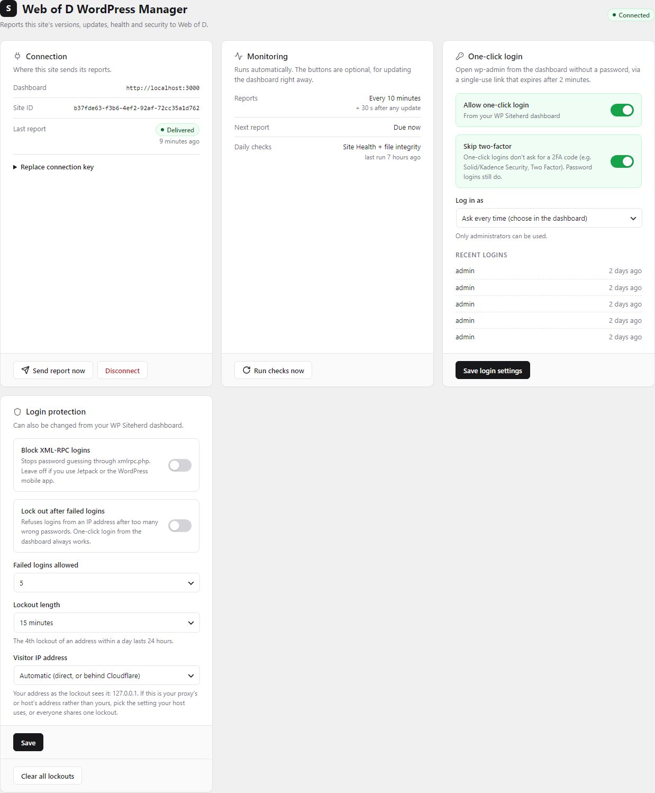

# WP Siteherd: WordPress plugin

The companion plugin for the **[WP Siteherd dashboard](https://github.com/slightgrey/siteherd-app)**. Install it on each client site and paste the site's connection key. From then on, the site reports its versions, pending updates, Site Health, file integrity and failed logins, and it can be updated, rolled back, have plugins installed or removed, and be logged in to from the dashboard. The dashboard matches what the site reports against a vulnerability database, so no scanning runs on the site itself.



## Requirements

- WordPress 6.0+
- PHP 7.4+
- A dashboard reachable over HTTPS (plain `http://localhost` is allowed for local development)

## Installation

1. Download `wp-siteherd-<version>.zip` from the [latest release](https://github.com/slightgrey/wp-siteherd/releases/latest), then upload it in **Plugins → Add New → Upload Plugin** and activate it.
2. In the dashboard, add the site and copy its **connection key**.
3. In WordPress, go to **Settings → WP Siteherd**, paste the key and save.

The page shows the connection status, the next automatic report and the daily checks. It warns when WP-Cron is running late, and gives the `wp-cron.php` URL to call from a real server cron. That's recommended for low-traffic sites, because WP-Cron only runs on page visits.

## What it reports

Every 10 minutes, and about 30 seconds after any plugin, theme or core change:

- WordPress, PHP and database versions, multisite flag, locale
- Installed plugins and themes with their versions, active state and pending updates
- Pending core and translation updates
- Failed logins in the last 24 hours (hourly counts only, with no usernames or IP addresses)

Once a day (or on demand with **Run checks now**):

- **Site Health:** WordPress's own Site Health tests, including the details of each issue
- **File integrity:** core files and wordpress.org plugins compared with the official checksums. Changed, missing and unexpected files are reported. Premium and custom plugins are listed as "can't be checked".

## Remote actions

All of these are triggered from the dashboard and require a correctly signed request:

- **Updates:** plugins, themes, core and translations, run in the background with WordPress's own upgraders. Each plugin and theme is backed up first. After updating, the home page and login page are loaded, and a fatal error or HTTP 5xx restores the backup automatically.
- **Rollback:** restore the version kept from the last update (kept for 30 days), or install an earlier release from wordpress.org.
- **Install plugins** from wordpress.org, optionally activating them.
- **Activate / deactivate plugins.** After activating, the site is loaded again; if it stops loading, the plugin is deactivated again. A PHP fatal error during activation is caught and reported.
- **Delete plugins** with WordPress's own deletion (which runs the plugin's uninstall routine). The plugin is deactivated first, and a copy of its files is kept in `wp-content/siteherd-backups` for 30 days. WP Siteherd never deactivates or deletes itself.
- **Resync:** refresh WordPress's update information and send a report immediately.
- **One-click login:** a signed, single-use link (valid 2 minutes) logs an administrator into wp-admin. It can be turned off, or limited to one administrator, on the settings page. The last 20 logins are listed there. By default it skips two-factor plugins (Solid/Kadence Security, Two Factor, WP 2FA and similar), since the dashboard login and the signed token stand in for the second factor; switch **Skip two-factor** off to require the code. Logins with a password on wp-login.php always ask for it.
- **White label:** when the dashboard has an agency name set (Settings → White label), the Settings menu item and this plugin's page read "{Agency} WordPress Manager" instead of WP Siteherd. The name arrives with the dashboard's signed answer to each report. Clearing it, or disconnecting, goes back to WP Siteherd. The Plugins list always shows WP Siteherd.

## Updates

WP Siteherd isn't in the wordpress.org directory, so it updates itself from this repository's [GitHub releases](https://github.com/slightgrey/wp-siteherd/releases). New releases appear in **Dashboard → Updates**, work with WordPress auto-updates, and show up in the WP Siteherd dashboard like any other plugin update. The release check is cached for 12 hours.

Development copies (a checkout with `composer.json`) never update themselves. You can also turn updates off with `define( 'SITEHERD_DISABLE_SELF_UPDATE', true );` in `wp-config.php`.

## Security

- The connection key holds a secret unique to the site. It's stored in a non-autoloaded option and never shown again.
- Every request in both directions is signed with HMAC-SHA256 over `"{timestamp}.{raw body}"`, sent in the `X-Siteherd-Site`, `X-Siteherd-Timestamp` and `X-Siteherd-Signature` headers. Incoming signatures are compared in constant time. The dashboard signs its answer to a report the same way, and the plugin ignores an answer that doesn't verify.
- Requests older than 5 minutes are rejected, and replayed signatures are blocked.
- Checksums are fetched over HTTPS only.
- Admin actions use nonces and require `manage_options`.

## REST endpoints

All endpoints are under `/wp-json/siteherd/v1/` and require a signed request.

| Endpoint | |
|---|---|
| `GET status` | The same payload as a report |
| `POST sync` | Refresh update info and send a report |
| `POST update` | Start an update or rollback job |

## Development

```bash
composer install
vendor/bin/phpunit                         # unit tests (no WordPress needed)
vendor/bin/phpunit --filter test_name      # a single test
php -l includes/class-siteherd.php         # syntax check
```

### Versions and releases

```bash
npm install                 # once: installs the zip tool
npm run version:patch       # 0.7.0 → 0.7.1 (or version:minor / version:major)
npm run bundle              # → dist/wp-siteherd-0.7.1.zip
```

`version:*` updates the version in `package.json`, the plugin header, `SITEHERD_VERSION` and `readme.txt` (Stable tag), and adds an empty changelog entry to `readme.txt` for you to fill in. `bundle` packs the plugin into a `wp-siteherd/` folder, leaves out development files (tests, Composer, npm, docs), and stops if the versions don't match.

To release, commit and push, then create a GitHub release tagged `v<version>` and attach the zip from `dist/`. Sites pick it up within 12 hours.

The code stays compatible with PHP 7.4. `Siteherd_Signer` (`includes/class-siteherd-signer.php`) is plain PHP so it can be unit-tested. It shares its test vectors with the dashboard's signing code.

```
wp-siteherd.php        bootstrap
includes/              core classes: collector, reporter, signer, updater, checks, SSO, REST API, self-update
scripts/               npm run bundle / version:* (release zip and version bumps)
admin/                 settings page and styles
tests/                 PHPUnit tests
```

## License

GPL-2.0-or-later, as stated in the plugin header. This repository is distributed under GPL-3.0; see [LICENSE](LICENSE).
